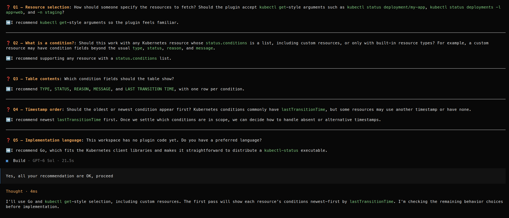
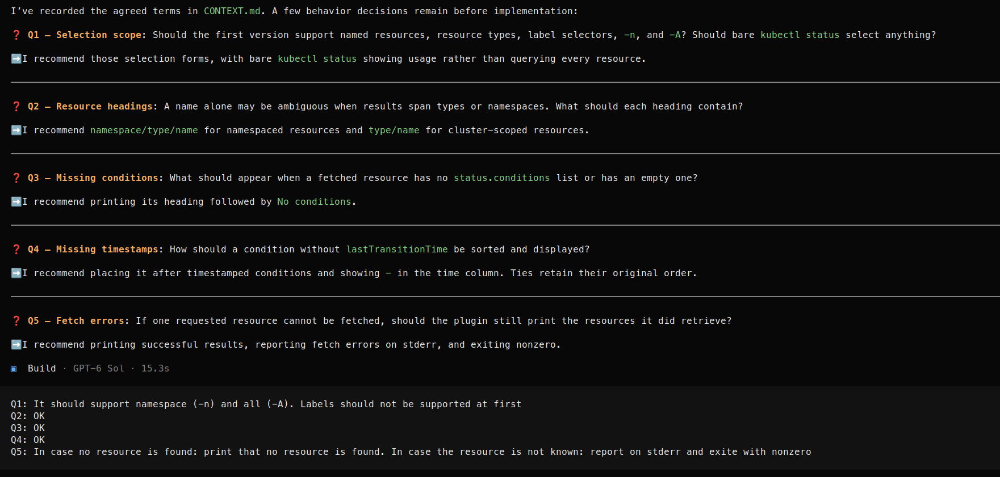

This a PoC of using skills from https://github.com/mattpocock/skills

* The Poc was run in [OpenCode](https://opencode.ai/docs/), using `gpt-6-sol` with GitHub Copilot.
* First the project was set up by execute `/skill` in opencode and select `setup-matt-pocock-skills` from the list of available skills. 
* Next the skill `grill-with-docs` was called. The skill then asks for `Loaded the grilling and domain-modeling skills. What would you like to work through?` and answer:
  ``` 
  I would like to implement an kubectl plugin, which fetches the given resources. For each retrieved resource, it should output the name and then a table of the status.conditions of the resource, sorted by timestamp
  ```
* During the execution, the model first asked a few questions, before start implementing the plugin: 
* After implementing the first version, the skill asked for a few more questions, before implementing the final version of the plugin: 